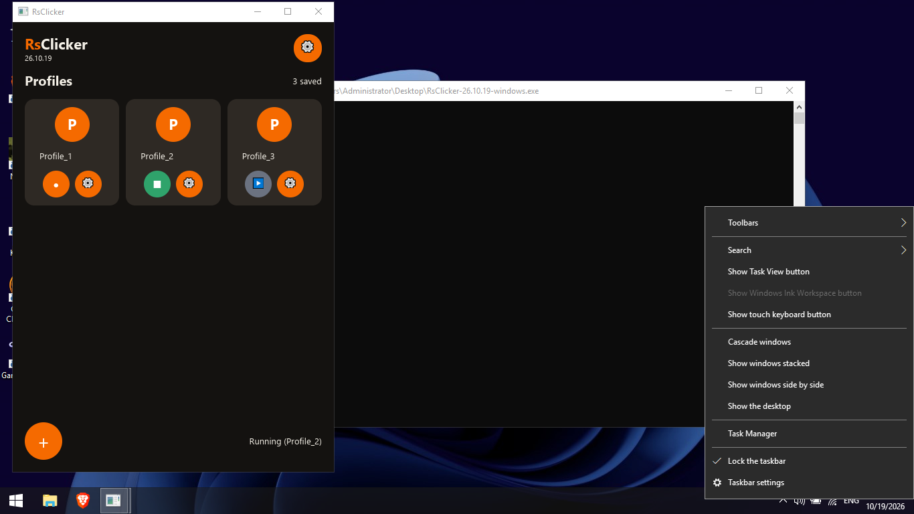
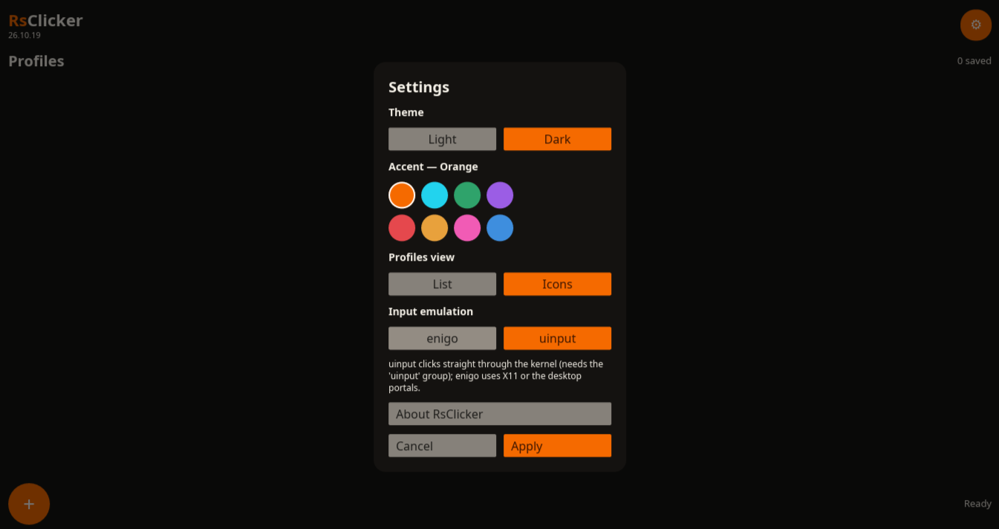

# RsClicker

[](LICENSE)
[](docs/VERSIONING.md)


A cross-platform auto clicker written in Rust.

Create profiles, arm them with a keyboard hotkey or a mouse button (including
side buttons), and fire precise click sequences anywhere. Built with
[iced](https://iced.rs) for the GUI, [enigo](https://github.com/enigo-rs/enigo)
for input emulation (plus an optional kernel-level **uinput** backend on
Linux), and raw input monitoring (evdev on Linux, rdev on Windows 10/11) for
global mouse triggers.



## Features

- **Profiles** — save named click configurations (interval, button, target);
  list or icon-grid views.
- **Triggers** — keyboard hotkeys (`F6`, `Control+R`…) or mouse buttons
  (left/right/middle/side/extra), captured by simply pressing them.
- **Press modes** — Toggle (press to run, press to stop) or Hold (runs while
  held, stops on release).
- **Targets** — current position, fixed coordinates, or a point sequence.
- **Multi-run** — arm and run several profiles at the same time; per-profile
  state colors: gray idle, orange listening, green running, red error.
- **Drift-free timing** — clicks follow a shared deadline train: the set
  interval holds even when an injection costs extra milliseconds.
- **Real double clicks** — a human-like 30 ms inter-click gap is recognized
  by X11, Wayland compositors and Windows alike.
- **Themes** — Light/Dark base × 8 accent colors, applied via settings.
- **Animated splash** with brand intro, modal dialogs, settings persisted to
  disk.

## Linux injection backends

How clicks reach the screen, switchable in *Settings → Input emulation*
(Linux only; Windows always uses native SendInput):

- **enigo** *(default)* — XTEST on X11, or the desktop portals
  (`RemoteDesktop`/libei) on Wayland.
- **uinput** — a kernel-level virtual mouse written straight to
  `/dev/uinput`: no X11 server and **no portals involved**, so it works
  everywhere the portals misbehave. Needs the `uinput` group:

  ```bash
  sudo usermod -aG uinput $USER   # log out and back in afterwards
  ```

  Missing permission surfaces as a red ERROR state with the fix hint —
  never a silent failure.



## Installation

### Pre-built binaries

Download the latest build for your platform from the
[Releases page](https://github.com/angrino/RsClicker/releases):

- `RsClicker-26.10.19-windows.exe` — Windows 10/11.
- `RsClicker-26.10.19-linux` — Linux tarball binary.

<!-- TODO: keep artifact names in sync with the release packaging
     (docs/BUILDING.md — Release packaging). -->

### Build from source

Requires a recent stable [Rust toolchain](https://rustup.rs).

```bash
git clone https://github.com/voidx9x/RsClicker.git
cd RsClicker
cargo build --release
./target/release/RsClicker
```

Windows cross-compilation and other build details are in
[docs/BUILDING.md](docs/BUILDING.md).

## Quick start

1. Press **+** to create a profile.
2. Open it with **⚙**, set timing/clicks/target, then **Capture** your trigger.
3. Back on the main screen press **▶** — it turns orange (listening).
4. Press your trigger key/button: green means clicking. Press again to stop.

More in [docs/USAGE.md](docs/USAGE.md) and [docs/FEATURES.md](docs/FEATURES.md).

## Requirements

### Linux

Wayland or X11.

- **Global hotkeys** need `org.freedesktop.portal.GlobalShortcuts`.
- **Clicking on Wayland** needs `org.freedesktop.portal.RemoteDesktop`
  (or the uinput backend above, which needs none of that). GNOME, KDE and
  Hyprland provide the portals; minimal compositors may not — the app
  reports this as a red ERROR state instead of crashing.
- **Mouse triggers** need read access to `/dev/input`. Add your user to the
  `input` group, then log out and back in:

  ```bash
  sudo usermod -aG input $USER
  ```

### Windows 10/11

Works out of the box (Win32 hotkeys, hooks, SendInput).

### macOS

Not currently supported.

## Disclaimer

Using auto clickers may violate the terms of service of some games and
online services, and can result in a ban. Use RsClicker responsibly and at your
own risk; the author is not responsible for any consequences.

## Project layout

```
src/
  main.rs            entry point
  app.rs             state, messages, update, subscriptions
  theme.rs           Light/Dark x 8 accents, shared widget styles
  trigger.rs         trigger model, key capture, armed routing
  mouse.rs           global mouse monitor (evdev / rdev)
  clicker/           click engine (own thread per profile) + injection backends
  hotkey/            global-hotkey service wrapper
  profile/           profile model + JSON store
  settings_store.rs  persisted app settings
  views/             splash, main, editor modal, dialogs
docs/                usage, features, architecture, building, versioning
```

See [docs/ARCHITECTURE.md](docs/ARCHITECTURE.md).

## Contributing

Bug reports, feature requests and pull requests are welcome.

- Found a bug or have an idea? [Open an issue](https://github.com/voidx9x/RsClicker/issues).
- Before sending a PR, please run `cargo fmt` and `cargo clippy`, and describe
  what you tested and on which platform.

## Credits

Developed with AI assistance ([opencode](https://opencode.ai)); design,
testing on real hardware, and all product decisions by me, ANGRINO.

## License

MIT — see [LICENSE](LICENSE).
